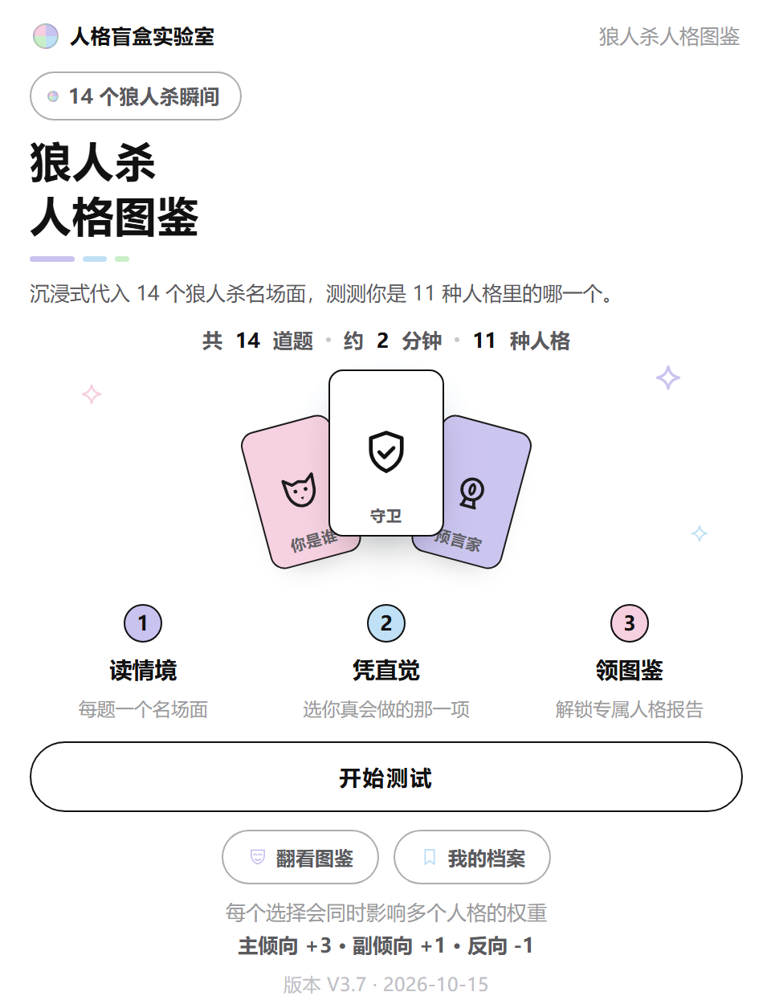
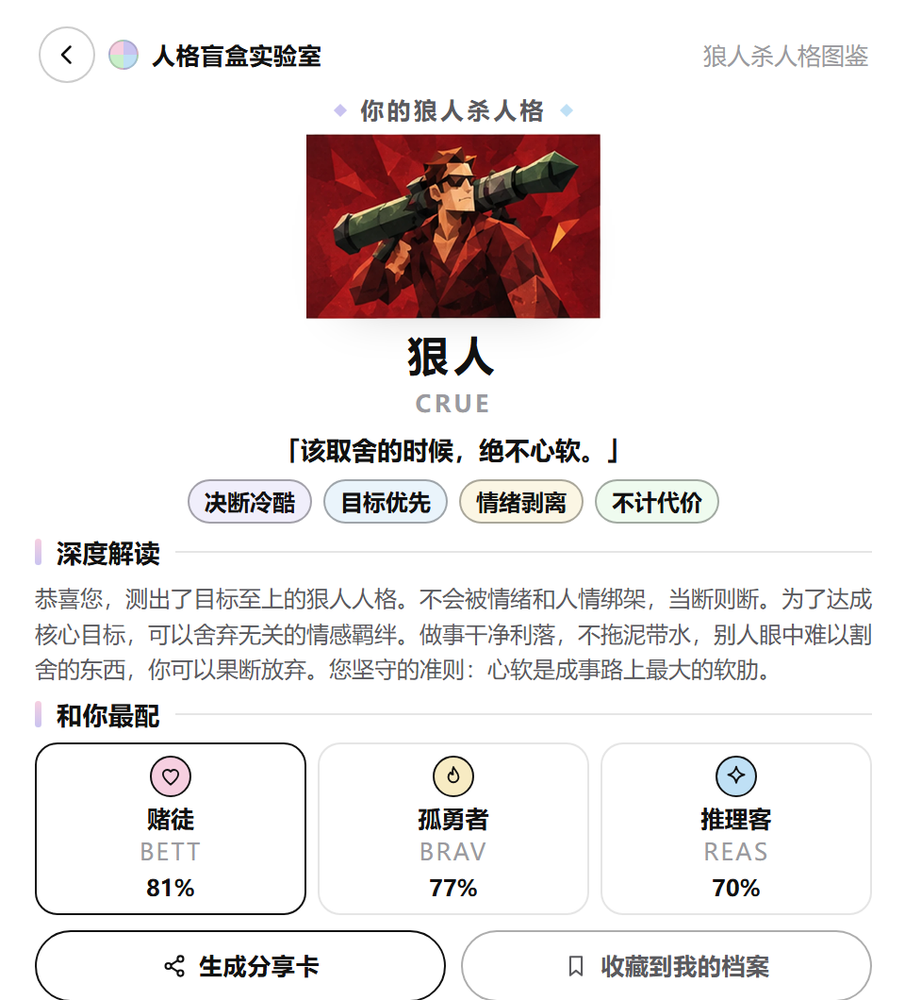
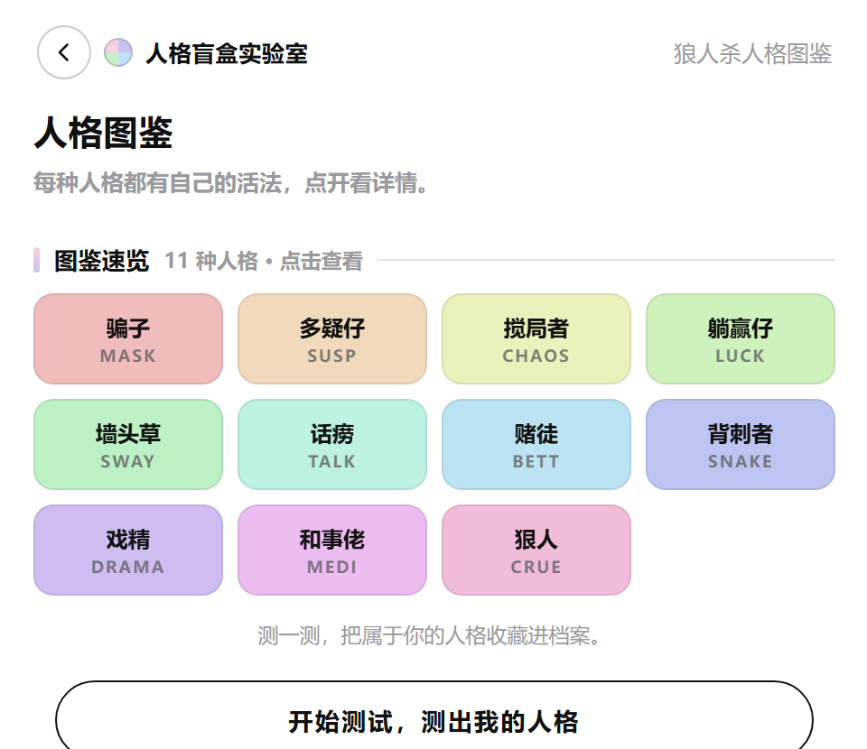
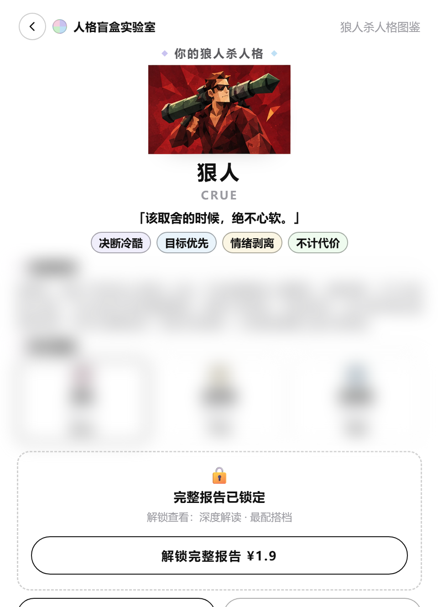

<div align="center">

# 狼人杀人格图鉴

**人格盲盒实验室 · 专题小测 N°01**

14 个狼人杀名场面 · 11 种牌桌人格 · 约 2 分钟

[在线体验](https://personaboxlab.com/) · [GitHub 镜像](https://8-321.github.io/personaboxlab/) · [完整报告说明](#免费版-vs-完整报告)

</div>

<p align="center">
  
  
  
</p>

> 免费测完即出人格卡。深度解读与最配搭档 **¥1.9 自愿解锁**——弹窗里也保留了「不请也行，直接看」，不付费同样能看完。

---

## 这是什么

不是「你像不像狼人」，而是把 14 个真实牌桌瞬间摆到你面前：

- 队友刚发完言就被全场踩，你要不要卖他？
- 昨晚刚守过预言家，今晚狼人会不会反着猜？还守吗？
- 你验到 8 号是狼，但他昨天逻辑清楚、还帮好人找狼——现在跳不跳身份？

每题 4 个选项，**选项不标身份**，凭第一反应选。系统按权重累计：**主倾向 +3 · 副倾向 +1 · 反向 −1**。14 题之后，权重最高的人格就是你的结果。

结果页先给出身份卡和四字标签；解锁后补上深度解读、3 位最配搭档与契合度。另有分享卡、重测与「我的档案」收集，集齐 11 种。

## 免费版 vs 完整报告

| 内容 | 免费 | ¥1.9 完整报告 |
| --- | :---: | :---: |
| 14 题测试 + 人格结果 | ✅ | ✅ |
| 身份卡 / 标签 / 分享卡 | ✅ | ✅ |
| 收藏到我的档案（0/11） | ✅ | ✅ |
| 深度解读（约 120 字） | 🔒 | ✅ |
| 最配搭档（3 位 + 契合度） | 🔒 | ✅ |

**关于收费，说明白：**

- 这是**自愿投喂**，不是硬付费墙；付款弹窗里有「不请也行，直接看」。
- 微信扫码，金额可选 **¥1.9 / ¥5 / ¥9.9 / 自定义**。
- 解锁状态只存在本机浏览器（`localStorage`），不绑定账号；换设备或清缓存需重新解锁。
- 不收密码、不收集手机号，也没有登录。

## 11 种人格

| 代号 | 人格 | 一句话 | 关键词 |
| --- | --- | --- | --- |
| MASK | 骗子 | 面具之下，真假全凭我定义。 | 擅长伪装、情绪演技、信息操控、底线灵活 |
| SUSP | 多疑仔 | 人人都有秘密，万事皆有伏笔。 | 警惕拉满、细节敏感、反向推演、很难信任 |
| CHAOS | 搅局者 | 平静没意思，乱起来才好玩。 | 讨厌沉闷、制造冲突、乐子优先、打破秩序 |
| LUCK | 躺赢仔 | 实力一般，但好运偏爱我。 | 佛系随缘、气运加持、低投入高回报、心态松弛 |
| SWAY | 墙头草 | 哪边风大，就往哪边靠。 | 审时度势、灵活转向、规避风险、立场可变 |
| TALK | 话痨 | 脑子想到什么，嘴巴先说出去。 | 表达欲爆棚、信息输出、气氛带动、很难闭嘴 |
| BETT | 赌徒 | 高风险背后，藏着高回报。 | 敢搏风险、相信直觉、取舍果断、不怕落空 |
| SNAKE | 背刺者 | 当面可以和睦，背后另有打算。 | 隐忍蓄力、伺机出手、表面友善、一击致命 |
| DRAMA | 戏精 | 生活就是舞台，随时可以入戏。 | 情绪饱满、擅长演绎、氛围感强、自带剧本 |
| MEDI | 和事佬 | 冲突没必要，大家各退一步。 | 厌恶争吵、调和矛盾、顾全大局、维持和平 |
| CRUE | 狠人 | 该取舍的时候，绝不心软。 | 决断冷酷、目标优先、情绪剥离、不计代价 |

<p align="center">
  
  
</p>

## 14 道题从哪来

题目全部是狼人杀对局里的具体场面，不是抽象选择题：

- 狼人视角 × 5：卖不卖队友、队友悍跳预言家、队友被点名、最后三人局怎么刀
- 村民视角 × 4：投错票之后、遇到全程附和的「NPC」、连续判断错的大佬、被狼人甩锅
- 女巫视角 × 2：第一晚救不救、救过的人跳预言家信不信
- 预言家视角 × 2：验到狼跳不跳、查到好人但操作离谱怎么说
- 守卫视角 × 1：继续守、换人守，还是赌冷门

没玩过狼人杀也能测——每题都把局面写清楚了，不需要懂规则。

## 隐私

- 所有计分、结果、档案都在**浏览器本地**完成，没有后端、没有账号、不上传答题记录。
- 收藏与解锁状态存在 `localStorage`；清除浏览器数据会一并清空。
- 页面不接入统计 SDK，不埋点。

## 适合谁

- 狼人杀玩家：想看看自己固定打法对应哪种牌桌人格。
- 喜欢情境测试的人：14 个名场面，比抽象量表更有画面感。
- 做内容/社群的人：结果卡适合分享，11 种人格可以当话题。

**不适合**：把它当专业心理测评。它是娱乐向人格鉴定，不是 MBTI，也不是临床量表。

## 常见问题

**Q：测一次多久？**
A：14 题，约 2 分钟。每题读完凭第一反应选即可。

**Q：可以重测吗？**
A：可以。结果页点「再测一次」随时重开。

**Q：能收集多个人格吗？**
A：可以。结果页点「收藏到我的档案」，集齐 11 种人格图鉴。

**Q：为什么答太快会被提醒？**
A：5 次选择发生在 3 秒内会触发一次提示，提醒看清局面再选；只提醒一次，不影响继续答题。

**Q：付费后换手机还能看吗？**
A：不能自动同步。解锁状态只在本机浏览器，换设备需要重新解锁。

**Q：数据存在哪里？**
A：只存在你的浏览器本地，不上传服务器。

## 技术实现

- **单文件**：`index.html`，HTML + CSS + JS + 题库 + SVG 图标 + 二维码全部内联。
- **零依赖**：没有框架、没有构建步骤、没有后端，可直接双击打开或静态托管。
- **移动优先**：480px 版心，桌面端居中显示。
- **纯前端**：权重计分、结果渲染、分享卡生成、档案收藏都在浏览器完成。
- **本仓库**：`index.html` 与线上页面为同一份文件，可直接作为 GitHub Pages 镜像。

```text
index.html          单文件测试（题库 / 样式 / 逻辑 / 图标全内联）
screenshots/        封面、答题、图鉴、锁定态、完整报告
.nojekyll           关闭 Jekyll，保证 Pages 原样输出
```

## 联系与支持

- 站点：[personaboxlab.com](https://personaboxlab.com/)
- 邮箱：3413765721@qq.com
- 如果它让你会心一笑，欢迎在站内扫码请实验室喝一杯；给这个仓库点个 Star 也是支持。

## 版本

- **V3.7 · 2026-10-15**：14 题权重版；11 种人格；完整报告 ¥1.9 自愿解锁；分享卡与人格档案。

## 免责声明

本测试仅供娱乐，不代表专业心理测评。狼人杀只是一个游戏，但牌桌上的你，是真的你。

题库、人格设定、文案与视觉版权归「人格盲盒实验室」所有；未经授权请勿商用或二次分发。

---

## English

**Werewolf Persona Atlas** — a 14-question, ~2-minute Chinese-language personality quiz set in real Werewolf game moments. It maps your choices onto 11 table-side archetypes (Mask, Skeptic, Chaos-Maker, Lucky One, Swayer, Talker, Gambler, Backstabber, Drama Queen, Peacemaker, Ruthless One).

The result card is free. A full report — deep reading plus your top 3 matches with compatibility scores — unlocks for **¥1.9 (voluntary)**; the paywall can also be skipped. Everything runs locally in the browser: no backend, no account, no tracking. Built as a single dependency-free `index.html` and mirrored on GitHub Pages.
